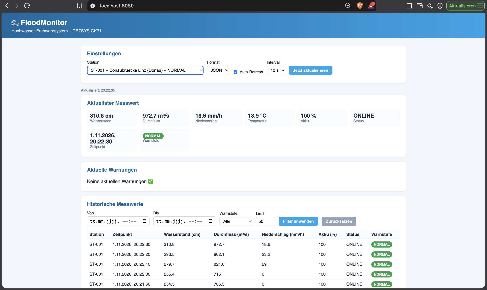
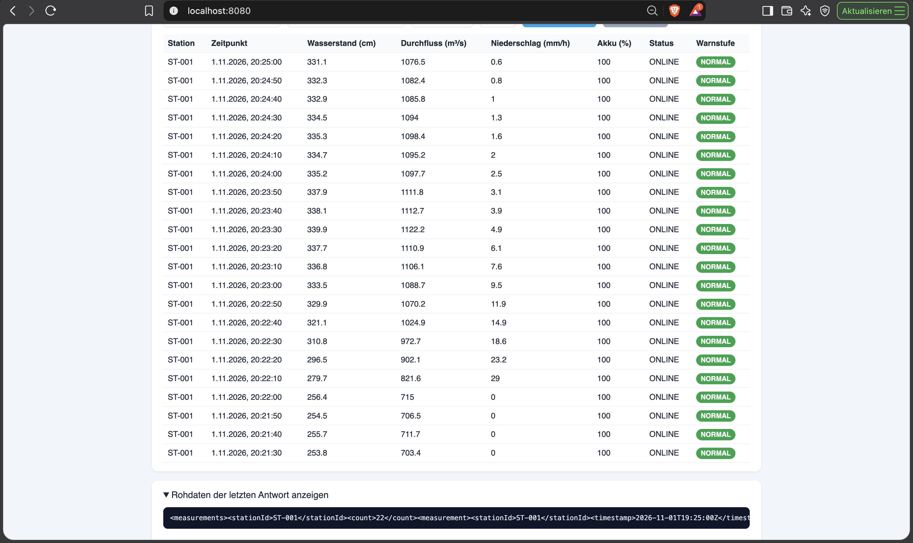

# DEZSYS_GK71 – FloodMonitor REST

**Autor:** Dorde Mihajlovic
**Repository:** https://github.com/dmihajlovic1/DEZSYS_GK71_FLOODMONITOR_REST

REST-Schnittstelle für ein Hochwasser-Frühwarnsystem. Mehrere Messstationen entlang von Flüssen erzeugen
simulierte Messwerte (Wasserstand, Durchfluss, Niederschlag, Temperatur, Akku). Die Daten werden über eine
REST-API als **JSON oder XML** bereitgestellt und in einem **jQuery-Webclient** angezeigt.

---

## Inhalt
1. [Start](#start)
2. [Architektur](#architektur)
3. [Datenmodell](#datenmodell)
4. [Simulationsregeln](#simulationsregeln)
5. [Warnstufen](#warnstufen)
6. [REST-API](#rest-api)
7. [Beispiele JSON und XML](#beispiele-json-und-xml)
8. [Fehlerbehandlung](#fehlerbehandlung)
9. [Webclient](#webclient)
10. [Tests](#tests)
11. [API-Dokumentation (OpenAPI)](#api-dokumentation-openapi)
12. [Reflexion](#reflexion)

Weitere Dokumente: [Fragestellungen](docs/FRAGESTELLUNGEN.md) · [AI-Prompts](docs/AI_PROMPTS.md)

---

## Start

**Voraussetzungen:** Java 17 oder 21 (nicht neuer, siehe Reflexion). Gradle wird über den Wrapper mitgeliefert.

```bash
./gradlew bootRun
```

| Was | URL |
|---|---|
| Webclient | http://localhost:8080/ |
| REST-API | http://localhost:8080/api/v1/stations |
| Swagger UI | http://localhost:8080/swagger-ui.html |
| OpenAPI (JSON) | http://localhost:8080/v3/api-docs |

**Tests ausführen:**
```bash
./gradlew test
```

### Konfiguration (`src/main/resources/application.properties`)
Die Konfiguration enthält keine geheimen Zugangsdaten.

```properties
server.port=8080
# Intervall der Simulation in Millisekunden
simulation.interval=10000
# Stacktraces nie an den Client senden
server.error.include-stacktrace=never
```

In den Tests (`src/test/resources/application.properties`) ist die Simulation mit
`simulation.enabled=false` abgeschaltet, damit die Tests deterministisch sind.

---

## Architektur

```
src/main/java/com/example/floodmonitor/
├── model/        Datenklassen und Enums (Station, Location, Measurement, WarningLevel, StationStatus)
├── repository/   In-Memory-Speicher (StationRepository, MeasurementRepository)
├── service/      Geschäftslogik
│   ├── SimulationService      erzeugt regelmäßig Messwerte (@Scheduled)
│   ├── WarningLevelService    berechnet die Warnstufe
│   ├── StationService         Stationen + Filter + aktuelle Warnstufe
│   ├── MeasurementService     aktueller Wert, Historie, Statistik
│   └── AlertService           aktuelle Warnungen
├── controller/   HTTP-Schicht (StationController, AlertController, QueryParams)
├── dto/          Antwortobjekte (Listen-Wrapper, Alert, Statistik, ApiError)
├── exception/    Exceptions + GlobalExceptionHandler (@RestControllerAdvice)
└── config/       OpenAPI-Konfiguration
src/main/resources/static/   Webclient (index.html, style.css, app.js)
```

**Ablauf einer Anfrage:**
`Client → Controller (Parameter prüfen) → Service (Logik) → Repository (Daten) → Controller → JSON/XML`

- Die **Controller** enthalten keine Geschäftslogik. Sie lesen nur Parameter (über `QueryParams`) und rufen Services auf.
- Die Daten liegen **im Arbeitsspeicher** (ConcurrentHashMap). Nach einem Neustart beginnt die Historie wieder bei 0.
- Das **Format** (JSON/XML) wählt Spring automatisch anhand des `Accept`-Headers (Content Negotiation). Für XML
  ist `jackson-dataformat-xml` eingebunden.

---

## Datenmodell

### Station
| Feld | Typ | Beschreibung |
|---|---|---|
| id | String | z. B. `ST-001` |
| name | String | Name der Messstelle |
| river | String | Fluss |
| location | Location | `latitude`, `longitude` |
| normalWaterLevel | double | normaler Wasserstand (cm) |
| warningWaterLevel | double | ab hier WARNING (cm) |
| criticalWaterLevel | double | ab hier CRITICAL (cm) |
| isActive | boolean | deaktivierte Stationen messen nicht |
| status | StationStatus | ONLINE, MAINTENANCE, OFFLINE |
| warningLevel | WarningLevel | aktuelle Warnstufe (vom Server berechnet) |

### Measurement
| Feld | Typ | Einheit |
|---|---|---|
| stationId | String | |
| timestamp | Instant | ISO-8601 (UTC) |
| waterLevel | double | cm |
| flowRate | double | m³/s |
| rainfall | double | mm/h |
| temperature | double | °C |
| batteryLevel | int | % |
| status | StationStatus | |
| warningLevel | WarningLevel | |

### Enums
- **WarningLevel:** NORMAL, WARNING, CRITICAL, UNKNOWN
- **StationStatus:** ONLINE, MAINTENANCE, OFFLINE

### Vorhandene Stationen
| ID | Name | Fluss | Normal | Warnung | Kritisch | Status |
|---|---|---|---|---|---|---|
| ST-001 | Donaubruecke Linz | Donau | 250 | 350 | 450 | ONLINE |
| ST-002 | Reichsbruecke Wien | Donau | 300 | 420 | 520 | ONLINE |
| ST-003 | Innbruecke Innsbruck | Inn | 180 | 260 | 330 | ONLINE |
| ST-004 | Staatsbruecke Salzburg | Salzach | 200 | 320 | 420 | ONLINE |
| ST-005 | Hauptbruecke Graz | Mur | 150 | 250 | 330 | OFFLINE |

ST-005 ist absichtlich OFFLINE, um zu zeigen, dass ausgefallene Stationen keine Messwerte erzeugen.

---

## Simulationsregeln

Der `SimulationService` erzeugt alle `simulation.interval` Millisekunden (Standard 10 s) für jede Station eine
neue Messung. **Jeder neue Wert wird aus dem vorherigen Wert derselben Station berechnet**, dadurch ändern sich
die Werte nicht völlig zufällig.

| Regel | Umsetzung |
|---|---|
| Keine Messung für inaktive/ausgefallene Stationen | `isActive == false` oder Status `OFFLINE` → übersprungen |
| Erste Messung | Wasserstand 95–105 % des Normalwerts, kein Regen, Akku 70–100 %, Temperatur 10–18 °C |
| Niederschlag | klingt pro Messung um 20 % ab (`× 0.8`); mit 8 % Wahrscheinlichkeit beginnt ein Schauer (+5 bis +30 mm/h) |
| Regen erhöht den Wasserstand | Anstieg = Niederschlag × 0,8 cm |
| Rückgang zum Normalwert | − (Wasserstand − Normalwert) × 0,03 |
| Kleine natürliche Schwankung | + Zufallswert (Normalverteilung, σ = 1 cm) |
| Keine Sprünge | Änderung pro Messung auf ±30 cm begrenzt |
| Nie negativ | Wasserstand mindestens 0 |
| Höherer Wasserstand → höherer Durchfluss | Durchfluss = 0,1 × Wasserstand^1,6 (Pegel-Abfluss-Kurve) |
| Temperatur | vorheriger Wert ± kleine Schwankung (σ = 0,2 °C) |
| Akku | sinkt mit 10 % Wahrscheinlichkeit pro Messung um 1 %; immer zwischen 0 und 100 % |
| Wartung | Akku ≤ 10 % → Status `MAINTENANCE`; dann wird pro Messung um 8 % geladen, ab 90 % wieder `ONLINE` |

---

## Warnstufen

Die Warnstufe wird **ausschließlich serverseitig** im `WarningLevelService` berechnet. Der Client kann sie nicht setzen.

| Bedingung | Warnstufe |
|---|---|
| Wasserstand < Warnwert | NORMAL |
| Wasserstand ≥ Warnwert | WARNING |
| Wasserstand ≥ kritischer Wert | CRITICAL |
| keine Messung oder ungültiger Wert (negativ) | UNKNOWN |

**Aktuelle Warnstufe einer Station** (`warningLevel` in der Station) ist zusätzlich `UNKNOWN`, wenn die Station
inaktiv oder OFFLINE ist oder die letzte Messung älter als 5 Minuten ist.

---

## REST-API

Basis-URL: `/api/v1`

| Methode | Endpunkt | Beschreibung | Filter / Parameter |
|---|---|---|---|
| GET | `/stations` | Alle Stationen | `river`, `isActive`, `warningLevel` |
| GET | `/stations/{stationId}` | Einzelne Station | |
| GET | `/stations/{stationId}/measurements/latest` | Aktuellster Messwert | |
| GET | `/stations/{stationId}/measurements` | Historische Messwerte (neueste zuerst) | `from`, `to`, `limit`, `warningLevel` |
| GET | `/stations/{stationId}/statistics` | Statistik | `from`, `to` |
| GET | `/alerts` | Aktuelle Warnungen (WARNING/CRITICAL) | `warningLevel`, `river` |

**Parameter-Regeln**
- `from`, `to`: ISO-8601, z. B. `2026-05-01T08:00:00Z` (inklusive); `from` darf nicht nach `to` liegen
- `limit`: 1 bis 1000, Standard 100
- `warningLevel`: NORMAL, WARNING, CRITICAL, UNKNOWN (Groß-/Kleinschreibung egal)
- `isActive`: `true` oder `false`
- `river`: Groß-/Kleinschreibung egal

**Statistik** enthält: Anzahl Messungen, niedrigster/höchster/durchschnittlicher Wasserstand, durchschnittliche
Durchflussmenge, Summe des Niederschlags, Anzahl WARNING-Messungen (`warningCount`) und Anzahl CRITICAL-Messungen
(`criticalCount`).

---

## Beispiele JSON und XML

Das Format wird über den `Accept`-Header gewählt. Ohne Accept-Header wird JSON geliefert.

### Alle Stationen (JSON)
```bash
curl http://localhost:8080/api/v1/stations
```

### Stationen filtern
```bash
curl "http://localhost:8080/api/v1/stations?river=Donau"
curl "http://localhost:8080/api/v1/stations?isActive=true"
curl "http://localhost:8080/api/v1/stations?warningLevel=CRITICAL"
```

### Aktuellster Messwert – JSON
```bash
curl -H "Accept: application/json" http://localhost:8080/api/v1/stations/ST-001/measurements/latest
```
```json
{
  "stationId": "ST-001",
  "timestamp": "2026-11-01T18:08:24Z",
  "waterLevel": 248.6,
  "flowRate": 680.3,
  "rainfall": 0.0,
  "temperature": 14.6,
  "batteryLevel": 84,
  "status": "ONLINE",
  "warningLevel": "NORMAL"
}
```

### Aktuellster Messwert – XML
```bash
curl -H "Accept: application/xml" http://localhost:8080/api/v1/stations/ST-001/measurements/latest
```
```xml
<measurement>
  <stationId>ST-001</stationId>
  <timestamp>2026-11-01T18:08:24Z</timestamp>
  <waterLevel>248.6</waterLevel>
  <flowRate>680.3</flowRate>
  <rainfall>0.0</rainfall>
  <temperature>14.6</temperature>
  <batteryLevel>84</batteryLevel>
  <status>ONLINE</status>
  <warningLevel>NORMAL</warningLevel>
</measurement>
```

### Historische Messwerte mit Filtern
```bash
curl "http://localhost:8080/api/v1/stations/ST-001/measurements?limit=5"
curl "http://localhost:8080/api/v1/stations/ST-001/measurements?from=2026-11-01T18:00:00Z&to=2026-11-01T19:00:00Z&limit=100"
curl -H "Accept: application/xml" "http://localhost:8080/api/v1/stations/ST-001/measurements?limit=3&warningLevel=NORMAL"
```

### Statistik und Warnungen
```bash
curl http://localhost:8080/api/v1/stations/ST-001/statistics
curl http://localhost:8080/api/v1/alerts
curl "http://localhost:8080/api/v1/alerts?warningLevel=CRITICAL&river=Donau"
```

---

## Fehlerbehandlung

Alle Fehler werden zentral im `GlobalExceptionHandler` (`@RestControllerAdvice`) behandelt und im einheitlichen
Format ausgegeben – je nach `Accept` als JSON oder XML. Es werden **keine Stacktraces** an den Client gesendet.

```json
{
  "timestamp": "2026-11-01T18:20:40Z",
  "status": 404,
  "error": "Not Found",
  "message": "Station ST-999 wurde nicht gefunden",
  "path": "/api/v1/stations/ST-999"
}
```

| Situation | Status | Beispiel |
|---|---|---|
| Erfolgreich | 200 | `GET /stations` |
| Unbekannte Station | 404 | `/stations/ST-999` |
| Noch keine Messung | 404 | `/stations/ST-005/measurements/latest` |
| Ungültiges Datumsformat | 400 | `?from=gestern` |
| `from` nach `to` | 400 | `?from=2026-12-01T00:00:00Z&to=2026-11-01T00:00:00Z` |
| Ungültige Warnstufe | 400 | `?warningLevel=XYZ` |
| `limit` negativ, 0 oder > 1000 | 400 | `?limit=5000` |
| `isActive` kein Boolean | 400 | `?isActive=vielleicht` |
| Format nicht unterstützt | 406 | `Accept: text/plain` |
| Falsche HTTP-Methode | 405 | `DELETE /stations` |
| Interner Fehler | 500 | ohne Details/Stacktrace |

```bash
curl -i http://localhost:8080/api/v1/stations/ST-999
curl -i "http://localhost:8080/api/v1/stations/ST-001/measurements?limit=5000"
curl -i -H "Accept: text/plain" http://localhost:8080/api/v1/stations
curl -i -H "Accept: application/xml" http://localhost:8080/api/v1/stations/ST-999
```

---

## Webclient

Der Webclient liegt in `src/main/resources/static/` und ist unter http://localhost:8080/ erreichbar
(HTML, CSS, jQuery).

Funktionen:
- Stationen laden (Dropdown mit aktueller Warnstufe)
- aktuellsten Messwert als Kacheln anzeigen
- aktuelle Warnungen anzeigen
- historische Messwerte als Tabelle (Station, Zeitpunkt, Wasserstand, Durchfluss, Niederschlag, Akku, Status, Warnstufe)
- Filter nach Zeitraum (Von/Bis), Warnstufe und Limit
- Umschalten zwischen **JSON und XML**: Der Client setzt den `Accept`-Header und wertet die Antwort selbst aus
  (`JSON.parse` bzw. `$.parseXML`). Beide Formate werden in dieselben JavaScript-Objekte umgewandelt.
- Rohdaten der letzten Antwort anzeigen (zeigt, dass wirklich JSON bzw. XML ankommt)
- automatische Aktualisierung (5 / 10 / 30 s)
- Ladeanzeige und verständliche Fehlermeldungen (inkl. „Server nicht erreichbar“)
- Farben: NORMAL grün, WARNING orange, CRITICAL rot, UNKNOWN grau

### Screenshots




---

## Tests

Automatisierte Tests mit JUnit 5 und MockMvc (`src/test/java`). Die Simulation ist in den Tests
deaktiviert, die Testdaten werden in `@BeforeEach` fest angelegt. Dadurch schlagen die Tests nie zufällig fehl.

| # | Test | Klasse |
|---|---|---|
| 1 | Alle Stationen als JSON | StationApiTest |
| 2 | Alle Stationen als XML | StationApiTest |
| 3 | Existierende Station | StationApiTest |
| 4 | Unbekannte Station (404) | StationApiTest |
| 5 | Aktuellster Messwert | StationApiTest |
| 6 | Filterung nach Zeitraum | StationApiTest |
| 7 | Ungültiger Zeitraum (400) | StationApiTest |
| 8 | Warnstufe NORMAL | WarningLevelServiceTest |
| 9 | Warnstufe WARNING | WarningLevelServiceTest |
| 10 | Warnstufe CRITICAL | WarningLevelServiceTest |
| 11 | Nicht unterstütztes Format (406) | StationApiTest |
| 12 | Maximales Limit (1000 ok, 1001 → 400) | StationApiTest |
| + | Warnstufe UNKNOWN ohne Messung | WarningLevelServiceTest |

---

## API-Dokumentation (OpenAPI)

Die API ist mit **springdoc-openapi** dokumentiert (Annotationen `@Operation`, `@Parameter`, `@ApiResponse`).
Dokumentiert sind Endpunkte, Methoden, Parameter, Response-Bodies, Formate (JSON/XML), Statuscodes,
Fehlerantworten (`ApiError`) und die Authentifizierung (keine – alle Endpunkte sind öffentlich und lesend).

- Swagger UI: http://localhost:8080/swagger-ui.html
- Exportierte Spezifikation: [`docs/openapi.yaml`](docs/openapi.yaml)

---

## Reflexion

- **Zwei Projektkopien:** Ich hatte das Repository zweimal auf dem Rechner. IntelliJ arbeitete in
  `~/IdeaProjects/…`, das Terminal in einem anderen Ordner. Dadurch landeten Commits im falschen Ordner.
  Lösung: immer das Terminal in IntelliJ verwenden und mit `pwd`/`git status` prüfen.
- **Java-Version:** Im Terminal lief Java 25, damit konnte das Gradle 8.7 des Projekts das Build-Skript nicht
  kompilieren („Unsupported class file major version 69“). Mit Java 21 funktioniert es.
- **Port 8080 belegt:** Eine alte Instanz der App lief noch, daher startete die neue nicht.
  Lösung: alte Instanz stoppen (`lsof -ti:8080 | xargs kill`).
- **`isActive` im JSON:** Jackson macht aus dem Getter `isActive()` den Namen `active`. Lösung: `@JsonProperty("isActive")`.
- **XML-Listen:** Eine einfache `List` wurde als `<List><item>…` ausgegeben. Mit eigenen Wrapper-Klassen und
  `@JacksonXmlRootElement` / `@JacksonXmlProperty` entsteht `<stations><station>…`.
- **Browser zeigt XML:** Der Browser schickt im Accept-Header `application/xml` mit höherer Priorität, deshalb
  liefert die API im Browser XML. Mit curl ohne Header kommt JSON – das ist korrekte Content Negotiation.
- **Webclient ohne CSS/JS:** Die Pfade in `index.html` passten nicht zur Ordnerstruktur.
- **Build-Dateien in Git:** `.gradle/` und `build/` waren mitcommittet. Lösung: `.gitignore`.
- **Datumsfelder:** Ein `datetime-local`-Feld ohne vollständiges Datum liefert einen leeren Wert, deshalb
  wurde kein Filter gesendet.
- **Speicher:** Die Daten liegen nur im Arbeitsspeicher und sind nach einem Neustart weg. Für einen echten
  Betrieb bräuchte man eine Datenbank.